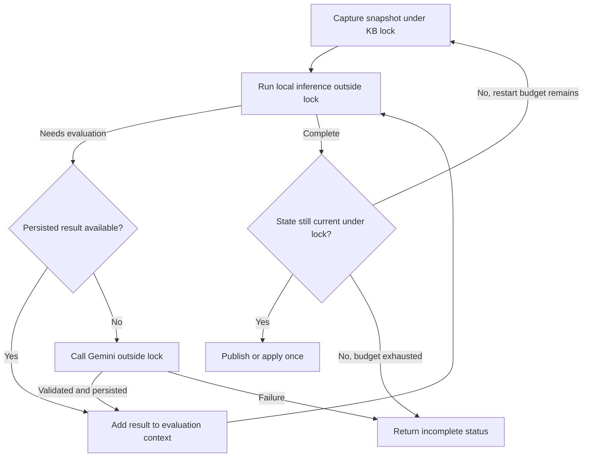

# Design: AI-evaluated derived attributes

**Status: proposed; not implemented.** This document describes the intended feature, not current behaviour.

Implementation: [detailed plan](ai_derived_attributes_implementation_plan.md).
Related designs: [derived definitions](../design/derived_attribute_definitions.md),
[inference](../design/rule_tree_and_inference.md), [chat](../design/chat_architecture.md),
[concurrent users](../design/concurrent_users.md), and [previews](../design/previewing_pending_changes.md).

## Purpose and scope

An expert defines what a derived attribute means in the chat. Gemini reads a named primary attribute in each case
and determines the derived value using that definition. The expert supplies interpretation criteria and examples;
they do not supply an algorithm. The stored definition is sufficient to evaluate future cases independently of the
conversation that created it.

The first release supports one existing primary (`EXTERNAL`) source attribute and a Boolean result. It supports
creation, editing the default definition, normal RDR assignment/removal/literal overrides, persistence, and use in
downstream conditions. The implementation is generic: diabetes-specific wording belongs in a KB definition, not
production code.

Multiple inputs, AI expressions consuming derived values, non-Boolean outputs, combining historical episodes, bulk
reclassification controls, and an additional model provider are outside this release. Ordinary formulas and comments
can still depend on the resulting Boolean attribute through the existing mechanisms.

## Meaning of hasDiabetes

Example request:

> Create an attribute called hasDiabetes derived from clinical_notes which has a true/false value based on whether
> those notes indicate that the patient has diabetes. Only evaluate when clinical_notes has a value.

For this user's definition, true means that the supplied notes affirm a personal history of diabetes, including
type 1 or type 2. Family history alone, suspected/questioned diabetes alone, and gestational diabetes alone do not
qualify. These are user-specified classification criteria, including the exclusion of gestational diabetes.

False means that the notes do not establish the specified personal history. It does not assert that the patient is
free of diabetes. Missing input and a failed evaluation are not false.

| Latest-episode clinical_notes | Expected outcome | Basis |
|---|---|---|
| `FH diab` | `false` | Family history only |
| `?diabetes` | `false` | Questioned diagnosis only |
| `gest diabetes` | `false` | Excluded by this definition |
| `Diabetic` | `true` | Affirmative personal history |
| `T2 Diab` | `true` | Affirmative type 2 history |
| `T1 diab` | `true` | Affirmative type 1 history |
| `No history of diabetes` | `false` | Explicit negation |
| `Routine follow-up for hypertension` | `false` | No affirmative diabetes history |
| `FH diab; patient has T2 diabetes` | `true` | A qualifying personal history is also present |
| Missing, empty, or whitespace-only | No assignment; no request | No input |
| Nonblank input, but Gemini unavailable | Evaluation error; no assignment | No classification obtained |

The complete note is evaluated. A family-history or gestational mention does not automatically negate an independent
affirmative statement about the patient. Contradictory or unintelligible notes are handled by the saved criteria;
the initial definition asks for affirmative evidence and otherwise returns false. It does not infer a diagnosis from
medication or test results alone. Further domain-specific distinctions can be added by editing the definition.

Read the value in the **latest case episode**, matching existing formula semantics. Do not search backwards for an
older nonblank value when the latest episode has no notes. A case with no episodes also supplies no input.

## Chat workflow

The authoring conversation and the case evaluator have separate responsibilities. The conversation helps the expert
define the classification; the evaluator applies that saved definition independently to each input.

1. Extract the requested attribute name, source name, and intended Boolean question.
2. Resolve the source against existing attributes. Ask about an unresolved or ambiguous name; do not create a source
   attribute or silently substitute a similar name. Reject derived/comment sources in this release.
3. Ask only about missing choices that change the meaning. For an initial diabetes request, these could include
   family history, suspected disease, and gestational diabetes. Do not ask again when the user has already specified
   them. Preserve their examples exactly and identify conflicting labels for the same example.
4. Present the assembled definition and examples. The server keeps a draft with a stable revision token so a reply
   such as "yes" accepts the exact definition shown, rather than an LLM reconstruction of it.
5. Evaluate a preview on the selected case if notes are available. Show the result as a **preview**, with a supporting
   excerpt where available. With missing notes, show "No clinical_notes value; not evaluated"; creating the definition
   is still allowed when a case is selected. Without a selected case, retain the draft and request a case, following
   the existing rule-building workflow.
6. Use the existing assignment session and cornerstone review to establish an `AssignValue(attribute, ByDefinition)`
   rule. With no reasons supplied, the assignment is unconditional; the evaluator's missing-input check supplies the
   guard. Existing reasons still constrain when the rule applies.
7. Commit the definition and rule through the normal workflow. Cancellation discards the draft and pending definition.
   The draft name must be available for another attempt, without deleting an attribute used by another session.

No separate permanent editor or settings panel is required. The existing Derived attributes panel presents results;
chat remains the surface for creation, correction, retry, and explanation. Preview evaluation does not materialise a
committed value on the live case. The pending panel continues to show the definition being assigned; the preview
classification can be carried in the chat response alongside it.

A request to change the meaning everywhere edits the stored definition and creates a new revision. It follows the
existing global-definition editing behaviour: no rule mutation or automatic cornerstone review. A case-specific
exception uses the normal RDR replacement/removal workflow and cornerstone review. Literal `true` and `false`
overrides remain possible. Changing evaluator model/settings is an explicit definition revision, not a side effect
of changing the model used for chat.

## Stored definition

Add a serializable `AiBoolean` subtype of `ValueExpression`, held in the existing `DerivedDefinitionStore`. Proposed
fields are:

| Field | Purpose |
|---|---|
| `sourceAttribute: Attribute` | Reference by stable attribute ID; display its current name |
| `instructions: String` | Expert-approved interpretation criteria |
| `examples: List<AiBooleanExample>` | Input text and expected Boolean, optionally a short explanation |
| `revision: String` | Opaque server-generated token, stable from preview to commit; new on a semantic edit |
| `evaluationProfile: AiEvaluationProfile` | Provider, model identifier, generation settings, and versioned prompt/schema policies |

The default profile is supplied by server configuration when a definition is drafted and then stored in the
definition. Credentials remain server configuration. Do not store credentials, SDK clients, callbacks, chat history,
or results inside an expression. Do not silently fall back to a different model when a model is unavailable.

`referencedAttributes()` returns the source, `alignAttributes()` resolves it by ID, and `asText()` supplies a readable
description such as "AI Boolean from clinical_notes: personal diabetes history". Renaming the target or source does
not change its meaning or revision. Validation rejects blank instructions, missing sources, non-primary sources,
conflicting duplicate examples, unsupported profiles, and name collisions before starting a session.

The definition JSON can use the existing expression column; the evaluation record store described below is new.
Existing literal/formula/template/ByDefinition JSON remains readable. Values are Boolean inside the evaluator and
are materialised as canonical `"true"` or `"false"` strings through the existing case-value representation. This
release does not require a general typed-attribute migration.

## Evaluation boundary and deterministic inference

`ValueExpression.evaluate(case)` currently evaluates local expressions. An AI expression must not make a network
request from that shared model method. Introduce a server-side `ValueExpressionEvaluator` used by `RuleTree` after
`ByDefinition` resolution. Its default implementation delegates existing expression types to their current methods.
For AI, it reads prepared results from an evaluation context. Direct local evaluation of `AiBoolean` fails clearly
as a programming error, like direct evaluation of `ByDefinition`; it must not silently return no value.

The evaluation context distinguishes these outcomes:

| Outcome | Meaning and handling |
|---|---|
| `Value` | Case-value string with optional AI provenance; AI Booleans become canonical `true`/`false` |
| `NoInput` | No usable source value; assign nothing and continue ordinary inference |
| `NeedsEvaluation` | Nonblank input without a prepared result; return a request to the coordinator |
| `Failed` | Evaluation did not succeed; interpretation is incomplete and has a diagnostic |

The provider adapter returns a typed Boolean. The common evaluation boundary converts it to the existing string
representation so the same `Value` outcome also accommodates literal, arithmetic, and comment results.

`NeedsEvaluation` is not a temporary absence. Stop that speculative inference attempt before downstream rules can
use it as an absent attribute. Likewise, a failed evaluation must not become a normal missing value that activates
"hasDiabetes is not in case" rules. An incomplete interpretation is not published as a successful interpretation,
used to generate a report, or used to approve a rule/cornerstone review. Present the failed attribute and error;
do not present previous-version derived values or comments as current. Missing source input is different: it is
an ordinary, successful no-assignment outcome, so existing absence conditions retain their meaning.

Evaluate only expressions selected by rule assignments during inference, plus explicitly requested previews. Do
not evaluate every stored definition ahead of the rules. A suppressed/retracted assignment does not require AI
evaluation on that pass. An assignment that becomes relevant on a later pass can request a result then.

For an immutable case, rule tree, and definitions, repeated inference passes must observe the same prepared result.
The existing acyclic dependency graph is still checked; AI source references participate in dependency extraction.
Restricting sources to primary attributes makes their input independent of the fixpoint. The result cache is a
correctness requirement as well as a latency/cost optimisation. Temperature zero alone is not a reproducibility
guarantee.

## Run remote work outside the KB lock

`KBEndpoint` and `LockedRuleService` currently wrap most operations in a per-KB `ReentrantLock`. `RuleBuildingSession`
also interprets candidate trees and cornerstones synchronously. Simply injecting a Gemini caller into `RuleTree`
would hold this lock across network latency and would affect more than the case-view path.

Introduce an `AiInferenceCoordinator` around operations that may need evaluations:

1. Under the KB lock, capture an isolated snapshot of the case data, relevant tree/definitions, pending-definition
   overlay, and operation/session identity. Capture a revision token for relevant KB/session state.
2. Outside the lock, evaluate the snapshot with an immutable map of known results. If it returns `NeedsEvaluation`,
   load a persisted result or make a bounded Gemini request, then restart the pure snapshot calculation with that
   result. No live case interpretation, session state, or rule is mutated during these attempts.
3. Persist successful evaluations and use a single shared in-flight request per cache key to coalesce concurrent
   requests. Database record access and network work happen outside the KB lock.
4. Reacquire the KB lock and validate that the case, rules, definitions, and relevant session still match. If so,
   publish the completed interpretation or apply the prepared operation exactly once. If not, discard the proposed
   application and prepare again against current state; cached evaluations remain useful only for matching inputs.
5. Bound restarts when concurrent changes prevent completion, and return a retryable "case or knowledge base changed"
   outcome. A cancelled session, deleted case/KB, or switched conversation must not receive a late result.



Use a monotonic KB evaluation-state revision for interpretation-affecting mutations, plus a user-session revision
for pending definitions/conditions. Presentation-only changes need not invalidate a classification; realignment at
publication uses current attribute identities. The snapshot must not share mutable interpretation or tree state
with the live KB: existing case-copy helpers can share `Interpretation` and are not sufficient without inspection.

Planning and applying a mutation are separate operations. Never retry an arbitrary mutation callback after a cache
miss: it may already have created an attribute, changed a session, recorded a rule, or sent a push. Rule start,
condition changes, and commit all require preparation before the short locked application phase. Commit preserves
the existing stale-session, dependency-cycle, and new-cornerstone checks.

The same coordinator boundary covers ingestion, case retrieval, view construction, preview, original/candidate-tree
cornerstone comparisons, condition suggestions, and commit revalidation. Non-AI paths retain their local fast path.
Only service/orchestration boundaries need suspension; the rule engine stays synchronous and network-free.

## Gemini request and validation

Use a fresh one-shot request for each uncached input, separate from both chat and condition translation. Reuse the
existing Gemini client infrastructure behind an injectable adapter, with a dedicated structured-generation method.

The system instruction contains the versioned classification contract and approved definition/examples. The input
note is an encoded data field in a separate user message. Attribute names are display information, not additional
model context. Instruct Gemini to treat notes as data, ignore instructions within them, use only the supplied text,
and return the specified schema. Give the evaluator no tools, web grounding, or conversation history. Send only the
source text needed for this evaluation, not the whole case or identifiers.

Require JSON with exactly these fields:

```json
{
  "value": true,
  "evidence": "T2 Diab"
}
```

`value` is a JSON Boolean; `evidence` is a string or null. It is a short verbatim excerpt supporting the classification,
not a request for hidden reasoning. Allow null, particularly when false reflects no relevant mention. The server
validates types, fields, and any supplied excerpt against the source text; it never coerces `"false"`, `0`, free-form
prose, or a missing field to a Boolean. Schema-valid output can still misclassify a note, so quality evaluation is
separate from response validation. Gemini supports schema-constrained output; see
[Google's documentation](https://ai.google.dev/gemini-api/docs/generate-content/structured-output).

Bound attempts and total elapsed time. Initially use at most two provider attempts, a 30-second per-attempt limit,
and a 65-second overall deadline for one classification, including backoff. Retry transient transport failures,
rate limits, and service errors only within that deadline; invalid schema/evidence, refusal, unsupported profile,
or an oversized input fails explicitly. Never silently truncate the notes. Keep limits configurable and cover them
with fake-clock tests. Do not nest this budget inside the existing generic long retry policy. Cornerstone batches
need a separate bounded operation budget and bounded concurrency, with cancellable progress and no partial commit.

## Stable results, persistence, and lifecycle

Add a KB-owned `AiEvaluationStore` with in-memory and Postgres implementations. A record key comprises:

- definition revision and a canonical definition fingerprint (source ID, criteria, examples, evaluation profile);
- SHA-256 of the exact source text sent to Gemini;
- implicit KB scope from the owning store.

Canonical fingerprinting excludes display names and includes evaluator prompt/schema versions and generation
settings. Check blankness without changing nonblank input text. Identical notes under the same definition can share
a result across cases; different KBs cannot. Do not use Kotlin `hashCode()` as a persistent content fingerprint.

Store the Boolean, optional evidence, requested and provider-reported model version where available, profile and
definition fingerprints, input hash, evaluation timestamp, and a record ID for provenance. Do not duplicate the full
clinical note or persist raw prompts/responses in application logs. Evidence remains clinical data in the KB store.
Keep the definition/profile snapshot needed to explain older records even after a definition edit.

A successful result is durable before it becomes authoritative. A uniqueness constraint and insert-if-absent
semantics select one persisted result if duplicate requests race; all callers use that winner. A persistence failure
therefore makes the evaluation incomplete rather than allowing a value that may change after restart.

Failures are memoised for the current operation and coalesced for concurrent waiters, but not stored as successful
results. Apply a short configurable retry cooldown to avoid request storms; an explicit retry after failure starts
a fresh operation subject to the provider budget. A successful result is not regenerated just because a case is
reopened. A definition/profile edit gives a new revision; old records cannot satisfy it. A provider alias may change
behind a stored model name, so cached cases remain stable but new inputs are not guaranteed to reproduce an older
provider version. Use a version-pinned model identifier where available and retain returned version metadata.

Export/import preserves definitions, profile/policy versions, and successful evaluation records so that cornerstone
behaviour remains reproducible after a round trip. Validate record fingerprints on import; reject conflicting
records before partially importing them. Older exports with no evaluation directory remain valid. Old application
versions need not read the new expression type; report an unsupported format rather than reinterpret it as text.
Import itself does not call Gemini. A genuinely missing result is evaluated on the next relevant interpretation.

Preview records for a cancelled draft must not activate a definition or reserve its name. They may remain as
unreferenced records until explicit cleanup; automatic eviction is not part of this release because evicting an
authoritative result would change reproducibility. KB deletion removes its evaluation store with its other data.

## Presentation and external behaviour

Successful values appear in the existing Derived attributes panel. Show the AI definition, source, evidence, and
evaluation time in its detail/tooltip presentation. Technical model/profile identifiers can remain in diagnostic
details; they do not belong in the normal authoring dialogue.

No-input rows show "Not evaluated: no clinical_notes value". Failed evaluations show "Could not evaluate" and a
short reason. These display strings are not case values. Return typed status/provenance alongside the view DTO;
update its custom serializer rather than relying on a new constructor field alone. Rendering a view or tooltip
must not initiate another request.

An incomplete interpretation blocks report generation and rule commit. Ingestion retains the primary data and
reports an explicit incomplete status rather than returning an apparently successful interpretation. Keep existing
success payloads compatible; use a typed incomplete/error response for callers requesting interpretation, including
the retained case ID so they can retry the stored case. Derived values remain internal interpretation artefacts and
are not added to the external laboratory data feed. No input remains a normal successful interpretation.

## Validation and acceptance

Deterministic tests use Kotlin, JUnit 5, Mockk, Kotest matchers, and Given/When/Then comments. At least one failing
unit test precedes each production slice. Cover response validation, absent input, persistence, races, failure
semantics, repeat inference, downstream conditions, session cancellation, and original/candidate cornerstone trees.

Model-quality evaluation is a separate opt-in suite against a fixed, synthetic or approved corpus. It includes the
six user examples, mixed positive/exclusion notes, negation, irrelevant notes, abbreviations, contradictions, and
instructions embedded in notes. Record disagreements and model/profile versions. Mocked classifications cannot
demonstrate Gemini's medical-language accuracy. Require the six specified examples to pass and expert review of
failures in the extended corpus before adopting a profile; agree any numerical quality threshold with the owner.

The feature is complete when the user can create and revise the definition entirely through chat, its values drive
ordinary rules, missing input makes zero requests, identical input/revision stays stable across passes/restarts and
export/import, and failures or concurrent edits cannot silently create false values or stale interpretations.

## Alternatives considered

| Alternative | Reason for the proposed choice |
|---|---|
| Ask Gemini to generate a formula or program | The requested meaning is applied by Gemini at evaluation time; generated executable logic is a different feature |
| Classify once in the authoring chat and store a literal | Future cases need their own evaluation using a durable definition |
| Call Gemini directly from `ValueExpression.evaluate` | Couples shared code to transport and blocks existing locked inference paths |
| Evaluate all definitions before every rule run | Makes unnecessary requests and ignores rule selection, refinement, and removal |
| Rely only on a low temperature | Does not establish stable repeated results |
| Convert errors or missing notes to false | Conflates absence/failure with a valid negative classification |
| Add a new mandatory attribute editor | Chat already supplies the authoring workflow |
